<div align="center">

# Finances Pro

**Gérez vos finances projet par projet : revenus, dépenses, épargne et objectifs, tout au même endroit.**


</div>

---

## Présentation

**Finances Pro** est une application de bureau qui remplace les cahiers de comptes et les tableurs compliqués. Le principe est simple : **un dossier par projet** (un ordinateur à acheter, un voyage, un fonds d'urgence, un budget familial…). Dans chaque projet, vous suivez vos revenus, vos dépenses et votre épargne, et l'application vous montre où vous en êtes grâce à des graphiques et des conseils automatiques.

L'application fonctionne **entièrement hors ligne**. Vos données restent sur votre ordinateur, dans de simples fichiers CSV.

<p align="center">
  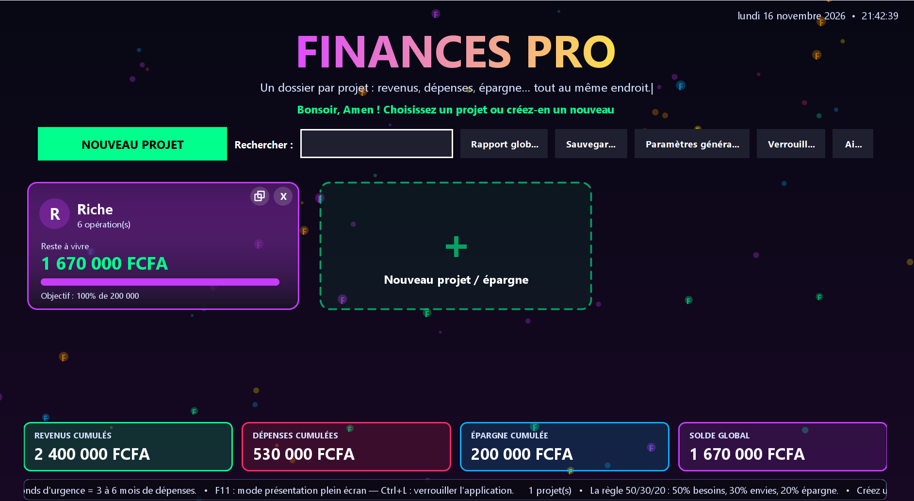
</p>
<p align="center">
  
</p>

## Aperçu

<table>
  <tr>
    <td width="50%">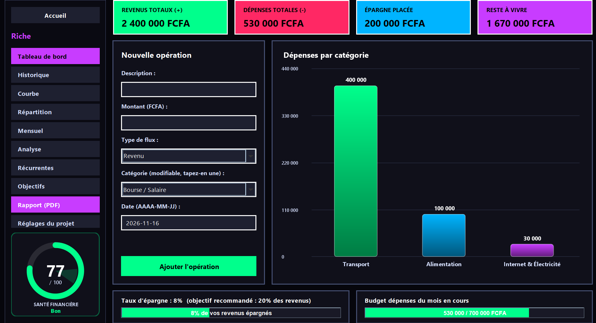<br><sub><b>Tableau de bord</b> : saisie d'une opération, dépenses par catégorie et score de santé financière</sub></td>
    <td width="50%">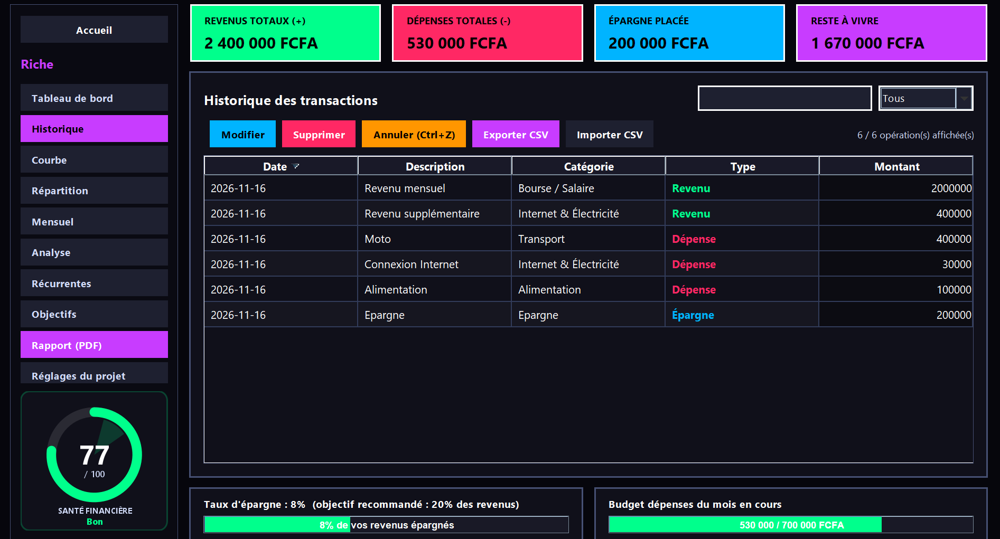<br><sub><b>Historique</b> : toutes les opérations, avec modification, annulation et import/export CSV</sub></td>
  </tr>
  <tr>
    <td width="50%">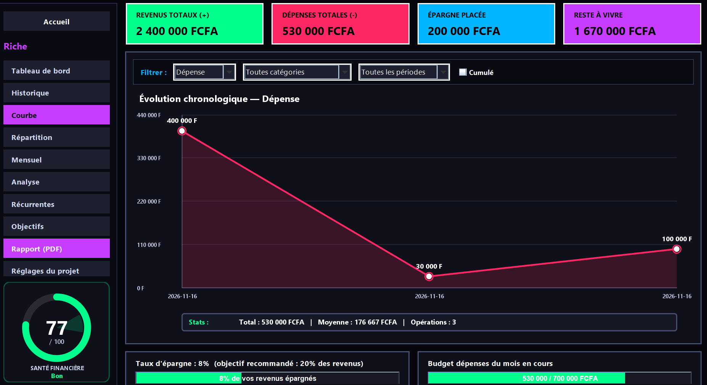<br><sub><b>Courbe</b> : évolution chronologique avec filtres par type, catégorie et période</sub></td>
    <td width="50%">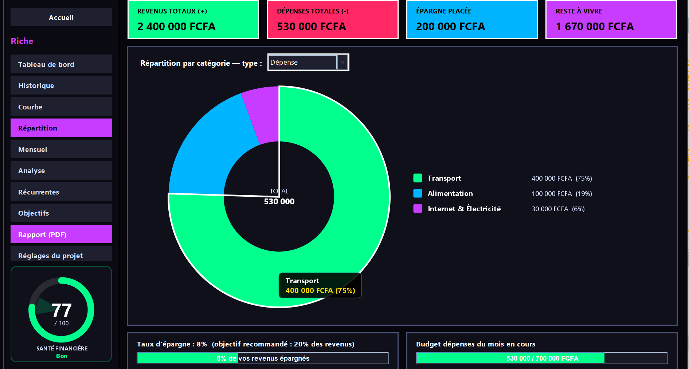<br><sub><b>Répartition</b> : diagramme circulaire des dépenses par catégorie</sub></td>
  </tr>
  <tr>
    <td width="50%">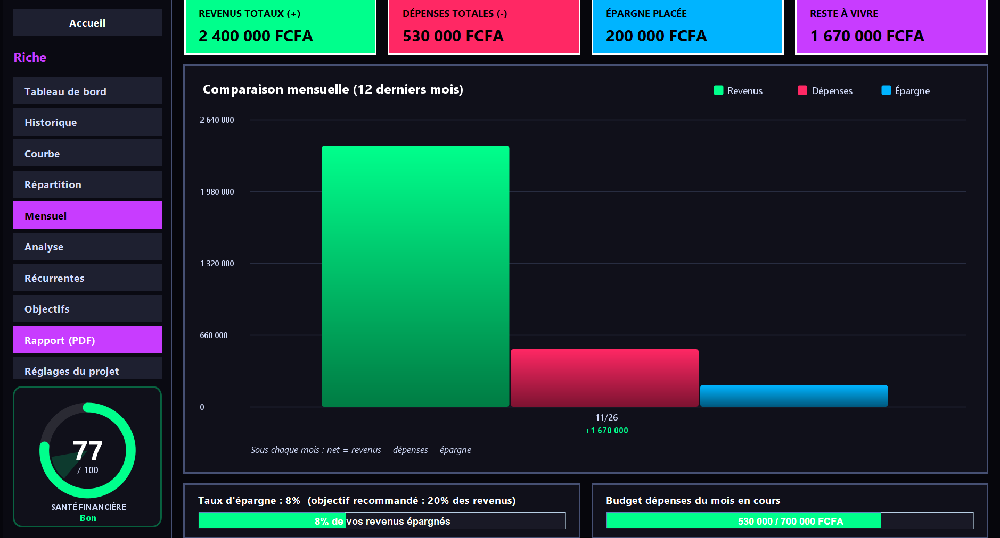<br><sub><b>Mensuel</b> : revenus, dépenses et épargne sur les 12 derniers mois</sub></td>
    <td width="50%">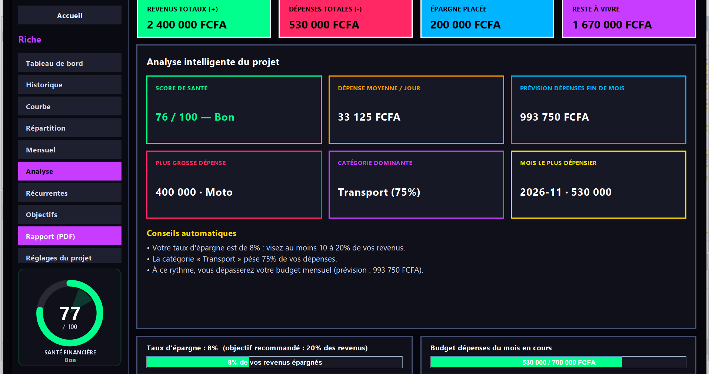<br><sub><b>Analyse</b> : indicateurs clés et conseils automatiques</sub></td>
  </tr>
  <tr>
    <td width="50%">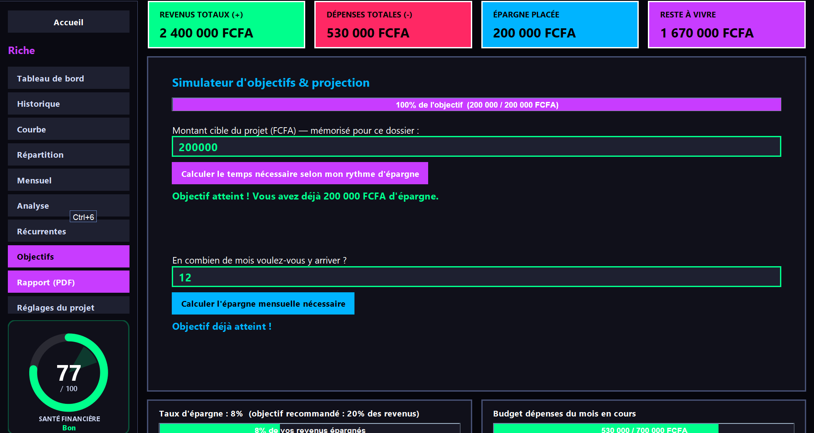<br><sub><b>Objectifs</b> : simulateur de projection d'épargne</sub></td>
    <td width="50%">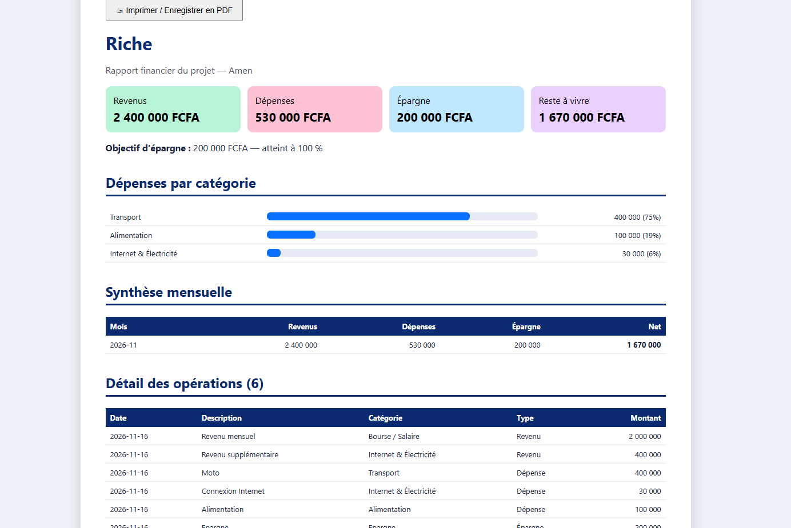<br><sub><b>Rapport</b> : document prêt à imprimer ou à enregistrer en PDF</sub></td>
  </tr>
  <tr>
    <td width="50%">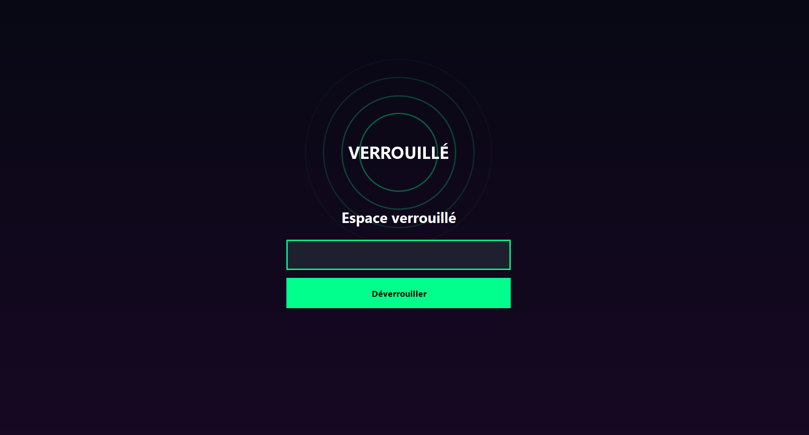<br><sub><b>Verrouillage</b> : l'accès est protégé par un code PIN</sub></td>
    <td width="50%">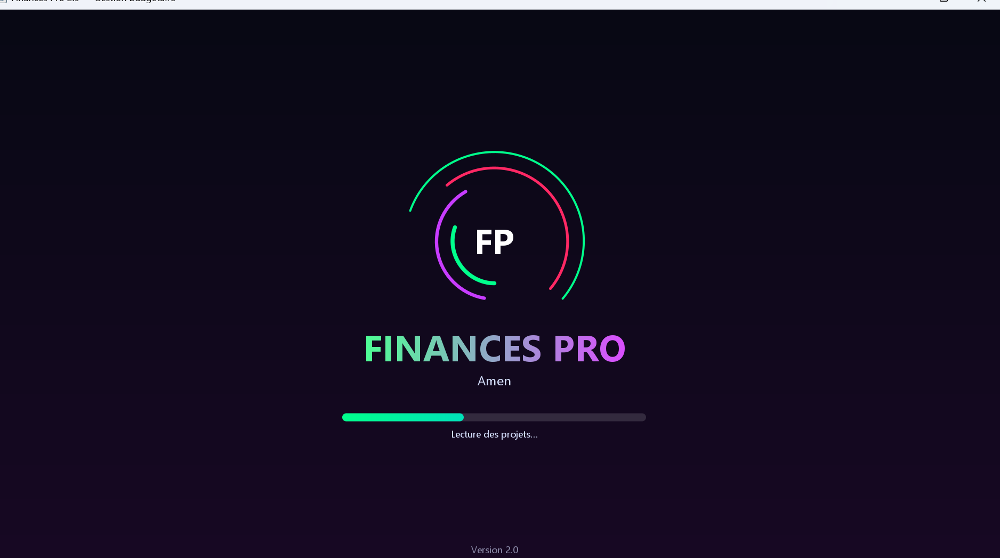<br><sub><b>Démarrage</b> : chargement animé des projets</sub></td>
  </tr>
</table>

## Fonctionnalités

### Gestion des projets
- Un projet par objectif, avec un **nom**, un **type** (Épargne, Maison, Voyage, Études…) et une **couleur**.
- **Budget mensuel de dépenses** et **objectif d'épargne** pour chaque projet, avec une barre de progression sur la carte.
- Alerte lorsque le budget du mois est dépassé.
- **Duplication** d'un projet en un clic.
- Recherche rapide parmi vos projets.

### Suivi des opérations
- Trois types d'opérations : **Revenu**, **Dépense** et **Épargne**.
- 11 catégories prêtes à l'emploi (Alimentation, Transport, Loyer, Santé, Éducation…).
- Modification, suppression et **annulation d'une suppression** (Ctrl+Z).
- **Import et export CSV** pour retrouver vos données dans Excel ou un autre outil.
- **Opérations récurrentes** : créez des modèles (loyer, abonnement, salaire) et appliquez-les pour le mois en un clic.

### Analyse et visualisation
Huit onglets par projet :

| Onglet | Ce qu'il apporte |
|---|---|
| Tableau de bord | Vue d'ensemble : revenus, dépenses, épargne et reste à vivre |
| Historique | Liste filtrable de toutes les opérations |
| Courbe | Évolution chronologique, avec option cumulée |
| Répartition | Diagramme circulaire des dépenses par catégorie |
| Mensuel | Comparaison sur les 12 derniers mois |
| Analyse | Analyse intelligente et conseils automatiques |
| Récurrentes | Gestion des opérations qui reviennent chaque mois |
| Objectifs | Simulateur : combien de temps pour atteindre l'objectif, ou combien épargner par mois |

### Rapports
- **Rapport par projet** et **rapport global** en HTML, prêts à imprimer ou à enregistrer en PDF depuis le navigateur.
- Le nom de votre organisation peut apparaître en en-tête des rapports.

### Sécurité et données
- **Code PIN** pour verrouiller l'application (Ctrl+L).
- **Sauvegarde automatique** (archive .zip) à chaque fermeture, avec 7 jours conservés.
- **Sauvegarde et restauration manuelles** depuis l'écran d'accueil.

### Confort d'utilisation
- Thème **sombre** ou **clair** (Ctrl+T).
- **Mode présentation** plein écran (F11).
- Devise **configurable** (FCFA par défaut) dans les Paramètres généraux.
- Interface entièrement en français.

## Raccourcis clavier

| Raccourci | Action |
|---|---|
| `F11` | Plein écran (mode présentation) |
| `Ctrl` + `N` | Nouveau projet ou nouvelle opération |
| `Ctrl` + `1` à `8` | Changer d'onglet dans un projet |
| `Ctrl` + `Z` | Annuler une suppression |
| `Ctrl` + `E` | Exporter en CSV |
| `Ctrl` + `R` | Générer le rapport imprimable |
| `Ctrl` + `H` | Retour à l'accueil |
| `Ctrl` + `L` | Verrouiller l'application |
| `Ctrl` + `T` | Changer de thème |

## Installation

### Option 1 : installateur Windows (recommandé)

1. Rendez-vous dans la section [**Releases**](../../releases) du dépôt.
2. Téléchargez `FinancesPro-2.0.exe`.
3. Double-cliquez et suivez l'assistant d'installation. Java est inclus, vous n'avez rien d'autre à installer.

> Windows peut afficher un avertissement « Éditeur inconnu » car l'installateur n'est pas signé. Cliquez sur **Informations complémentaires**, puis sur **Exécuter quand même**.

### Option 2 : lancer depuis le code source

**Prérequis :** [JDK 17](https://adoptium.net/) ou plus récent.

```bash
git clone https://github.com/Amen-pixel/finances-pro.git
cd finances-pro
javac -encoding UTF-8 -d out src/main/java/com/mycompany/tpjavagraphique/TpJavaGraphique.java
java -cp out com.mycompany.tpjavagraphique.TpJavaGraphique
```

Vous pouvez aussi ouvrir le projet dans **NetBeans** (projet Maven) et cliquer sur *Run*.

## Construire l'installateur

Avec le JDK, l'outil `jpackage` crée un installateur sans dépendance externe pour l'utilisateur final :

```bash
mvn clean package

jpackage --type exe --name "FinancesPro" --app-version 2.0 \
  --input target --main-jar TpJavaGraphique-1.0-SNAPSHOT.jar \
  --main-class com.mycompany.tpjavagraphique.TpJavaGraphique \
  --win-shortcut --win-menu --win-dir-chooser --dest installateur
```

Sous Windows, la création d'un `.exe` nécessite [WiX Toolset](https://wixtoolset.org/). Sans lui, remplacez `--type exe` par `--type app-image` pour obtenir un dossier portable.

## Où sont stockées mes données ?

Tout se trouve dans le dossier **`FinancesPro`** de votre dossier utilisateur :

```
~/FinancesPro/
├── projets.csv        # liste de vos projets
├── <projet>.csv       # les opérations de chaque projet
├── rapports/          # rapports HTML générés
└── sauvegardes/       # archives .zip automatiques
```

Une mise à jour ou une réinstallation de l'application **n'efface pas** vos données. Pensez tout de même à utiliser le bouton **Sauvegarde** de temps en temps et à copier l'archive sur une clé USB ou un cloud.

## Structure du projet

```
finances-pro/
├── README.md
├── pom.xml
├── docs/                      # captures d'écran du README
└── src/main/java/com/mycompany/tpjavagraphique/
    └── TpJavaGraphique.java   # application complète
```

L'application tient dans **un seul fichier**, sans bibliothèque externe : uniquement le JDK (Swing, AWT, `java.nio`).

## Conseils intégrés

L'application affiche pendant son utilisation de petits conseils financiers, par exemple :

- La règle **50/30/20** : 50 % besoins, 30 % envies, 20 % épargne.
- Un **fonds d'urgence** équivaut à 3 à 6 mois de dépenses.
- Épargnez dès que vous recevez de l'argent, pas à la fin du mois.

## Auteur

Développé par **Amen** ([@Amen-pixel](https://github.com/Amen-pixel)).

Une question, une idée, un bug ? Ouvrez une [*issue*](../../issues).

## Licence

Ce projet est distribué sous licence **MIT**. Voir le fichier `LICENSE` pour plus de détails.
